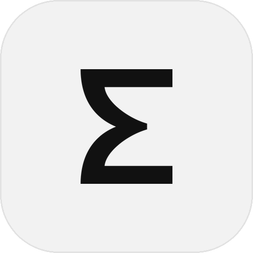

<div align="center">
  <a href="https://github.com/Genkaim/ydoo">
    
  </a>
</div>

<h1 align="center">ydoo</h1>

<p align="center">一款直接读取 Zepp / Amazfit 健康数据的 Android 客户端</p>

<p align="center">
  
  
  
  
</p>

界面是扁平的 Codex 风格：Material 3 语义色、等宽数字，无渐变、无阴影；深色/浅色跟随系统。底栏是可自定义顺序与显隐的悬浮胶囊。数据全部留在本机，不经过第三方服务器。

## 特色

- **三环概览** — 睡眠、Hybrid Charge、每日负荷三个环，标题带箭头可直接点进详情
- **每日负荷** — 心率冲量 + 步数 + 脑力折算，再按 HRV 与静息心率的偏离调整，压到 0–21；不属于官方分数，页面写明来源
- **Hybrid Charge** — 体力/精神/总分、当天曲线、近两周趋势；`255` 按「手表没算出来」处理
- **活动与运动** — 步数/消耗/活动三环、今日心率、近 7 天步数、14 天趋势；运动详情含逐秒曲线与 GPS 轨迹
- **AI 教练** — 主流聊天页布局：固定标题栏、贴着输入框滚动的会话流、建议问题贴在输入框上方、空态问候居中、上滑即停的跟随、回到底部按钮、复制与重新生成；兼容 OpenAI 的接入点，流式输出 Markdown 与数据卡片，历史会话留在本机；首轮注入七日摘要，问到更早的日期时才额外查表
- **饮食记录** — 拍照、从相册选，或者用一句话描述，都由 AI 估算 → 逐项确认（勾／叉）→ 本地保存；今日可编辑，添加食物直接弹条目编辑框，剩余热量与累计缺口
- **准备度与指标详情** — 睡眠分期、压力、PAI、最大摄氧量、体重、血氧、静息心率、HRV 都有独立详情页
- **缺失就是缺失** — 没有采样的指标显示 `--`，不补 0、不拿上一天顶替；快照超过 3 小时只显示 `--`

## 技术栈

- **语言**：Kotlin
- **UI**：Jetpack Compose + Material 3（Compose BOM 2025.09）
- **网络**：OkHttp（Zepp 区域接口 + 自填 AI 接入点）
- **图片/图表**：Canvas 手绘曲线与柱状图，无第三方图表库
- **存储**：本机 SharedPreferences + 应用私有目录的快照与饮食记录

## 安装

从 [GitHub Releases](https://github.com/Genkaim/ydoo/releases) 下载最新的 APK；也可以克隆后自行构建：

```bash
git clone git@github.com:Genkaim/ydoo.git
cd ydoo
./gradlew assembleRelease
```

## 构建

```bash
# Debug（无需签名）
./gradlew assembleDebug

# Release（当前用本机 debug 密钥签名，便于覆盖安装）
./gradlew assembleRelease

# 建议先 clean 再打包，避免缓存问题
./gradlew clean assembleRelease
```

产物在 `app/build/outputs/apk/`。minSdk 26，targetSdk 36。

## 登录与数据

应用内用 WebView 打开 Zepp 登录页，网页登录成功后从 `.zepp.com` 的 cookie 读取 `apptoken` / `userid`，再用 Zepp App 的请求头调用区域接口。支持邮箱密码、小米、Apple 等网页登录；Google 在 WebView 里会被拒绝，按钮已隐藏。接口清单、请求头与解析口径见 [docs/data-sources.md](docs/data-sources.md)。

## 隐私

- `apptoken` 与 AI 密钥只存在应用私有的 SharedPreferences，不写日志、不导出。
- 健康数据只在本机；对外请求只有 Zepp 区域接口和你自己配置的 AI 接入点。
- 明文 HTTP 只为自填的 AI 接入点放开，Zepp 接口全部走 HTTPS。

## 已知边界

- 只读：不改运动类型、不发训练计划。
- GPS 轨迹是没有底图的折线，不接地图瓦片服务。
- 部分指标取决于设备是否记录、云端是否保留；没有数据时显示 `--`，不代表设备不支持。
- AI 回答的质量取决于你选择的模型与接入点。

## 许可证

本项目基于 [MIT License](LICENSE) 开源。Zepp、Amazfit 及相关商标归其所有者。
